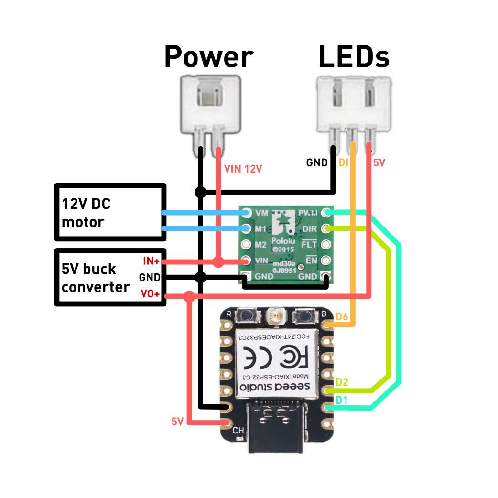

# 04-Moire_disc-DC_motor-fw

Firmware for the single-DC-motor version of the Moiré disc. One brushed DC
motor turns the disc through a Pololu MAX14870 driver, and a ring of 9
NeoPixels lights it from behind. You control everything from a smartphone. The
disc runs its own Wi-Fi network, and a web page served from it has the motor
and light controls.

It runs on a **Seeed XIAO ESP32-C3** or a **Seeed XIAO ESP32-C6**. Both use the
same source code and pins.

This is a rework of [04-Moire disc](https://github.com/KineticPrints/04-Moire_disc-controller_fw). That version drove two
stepper motors and took commands from a custom knob controller over ESP-NOW.

---

## Features

- **Wi-Fi access point + phone web page**: no app to install and no internet
  needed. The phone joins the `MoireDisc` network and the control page opens.
- **Motor control**
- **Light effects**
- **Settings are saved** in flash, 2 s after the last change. After a power
  cycle the disc starts with whatever was set last, so it runs on its own
  without a phone. The first boot uses slow motor speed and the Rainbow effect.
- **Several phones** can be connected at once. The page polls every 1.5 s, so
  every phone shows the same state.

---

## Using it

1. Power the disc. It starts with the last saved settings.
2. On the phone, join the Wi-Fi network **`MoireDisc`**. The password is
   **`moiredisc`**.
3. Most phones then open the control page on their own, as a "Sign in to
   network" page.
4. If the phone warns that the network has no internet, choose to **stay
   connected**.

### The control page doesn't open

The page lives at **http://192.168.4.1**. Type exactly that into the browser
address bar, including `http://`. Don't type it into the search box.

Only plain `http://` addresses get redirected to the control page. Almost every
website today uses `https://`, and the disc can't redirect those, so opening
your usual home page or google.com shows an error instead of the controls.

If **http://192.168.4.1** doesn't load either:

- **Turn off mobile data.** With no internet on `MoireDisc`, the phone may send
  everything over mobile data instead, and the disc never sees the request.
- **Android: turn off Private DNS** (Settings → Network & internet → Private
  DNS → Off). With Private DNS on, the phone skips the disc's DNS and the
  sign-in page never appears.
- **iPhone: turn off iCloud Private Relay and Limit IP Address Tracking** for
  the `MoireDisc` network (Settings → Wi-Fi → ⓘ next to `MoireDisc`).
- **Turn off "HTTPS-only" / "Always use secure connections"** in the browser,
  or use a different browser. Those settings refuse to open `http://` pages.
- **Check that you are still on `MoireDisc`.** Some phones drop a network with
  no internet after a few seconds and rejoin your home Wi-Fi. Forget the home
  network for a moment, or turn off "Switch to mobile data" / "Auto network
  switch".
- **Open the sign-in page by hand.** On Android, tap the `MoireDisc` network
  in the Wi-Fi list (or the "Sign in to network" notification). On iPhone, tap
  ⓘ next to the network.
- **Forget the network and join again**, or turn the phone's Wi-Fi off and on.
  Power-cycle the disc if nothing helps.

The status dot in the top right of the page turns green and shows how many
phones are connected. **Reset to defaults** at the bottom of the page restores
the first-boot settings.

---

## Hardware

| Part | Notes |
|---|---|
| Seeed XIAO ESP32-C3 **or** XIAO ESP32-C6 | Firmware builds for both |
| Pololu MAX14870 single brushed DC motor driver carrier | Control through DIR + PWM |
| S30K brushed DC gear motor | Drives the disc |
| 9 × WS2812B / NeoPixel LEDs | GRB, 800 kHz |
| Power supply | 9 V or 12 V DC, at least 1 A |

### Pinout

| XIAO pin | C3 GPIO | C6 GPIO | Connects to |
|---|---|---|---|
| **D1** | GPIO3 | GPIO1 | MAX14870 **PWM** |
| **D2** | GPIO4 | GPIO2 | MAX14870 **DIR** |
| **D6** | GPIO21 | GPIO16 | LED ring **DIN** (through a series resistor) |
| 5V | – | – | LED ring 5 V (and XIAO supply) |
| 3V3 | – | – | – |
| GND | – | – | common ground: MAX14870 GND, LED GND, supply GND |

## Custom perfboard PCB layout

The electronics sit on a hand-wired perfboard, with the XIAO and the MAX14870
carrier plugged into female headers so either one can be swapped.

